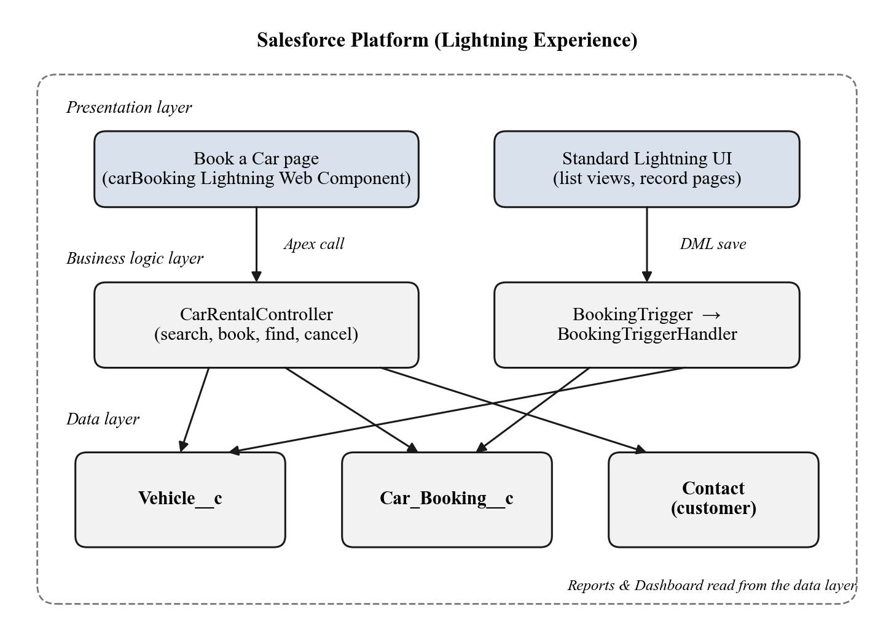
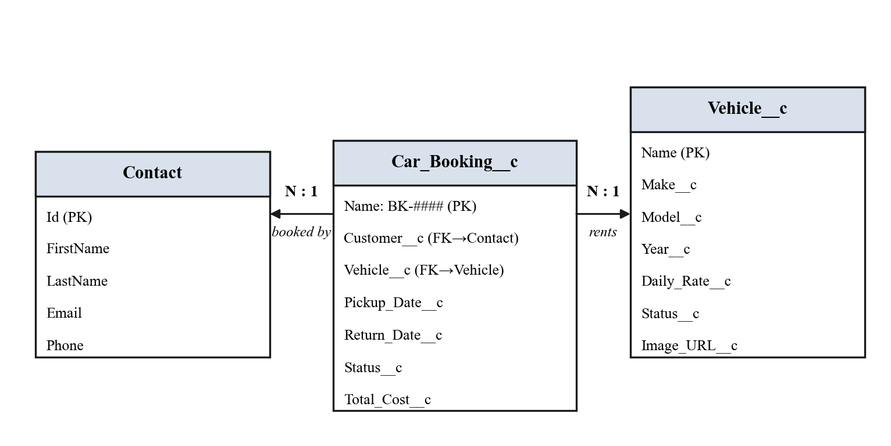
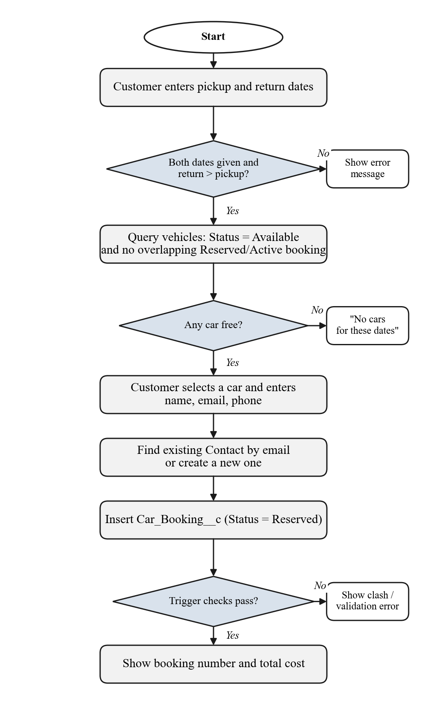
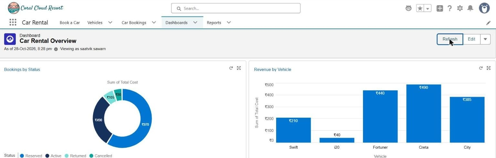
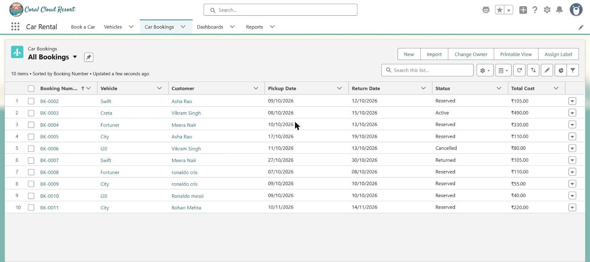
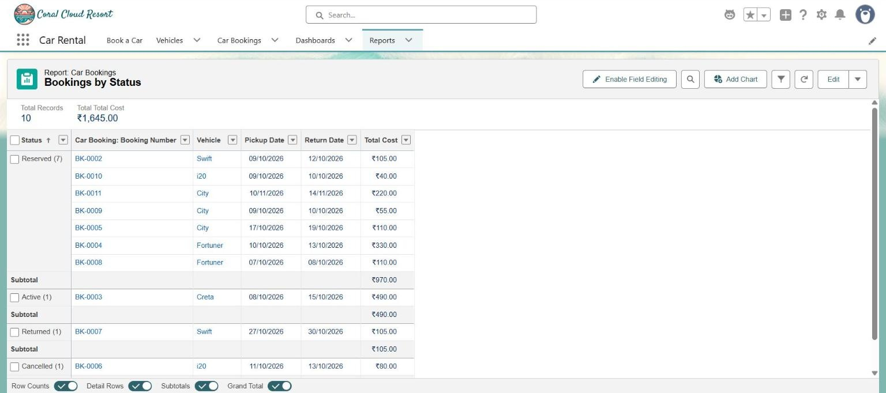

# SFCRS: Salesforce Car Rental System

A small car rental booking system built on the Salesforce platform. Customers search for cars that are free between two dates, see the exact price, book in one step and later find or cancel the booking. Staff manage the fleet and rentals, and the owner gets live figures, charts and an AI summary.

## Features

- **Date-based search**: only cars with status Available and no Reserved/Active booking overlapping the dates are shown.
- **Server-side rules** (Apex trigger): return date after pickup, no pickups in the past, no overlapping bookings of the same car, total cost = daily rate × days. The rules apply to every save, whichever screen it comes from.
- **Book a Car** (Lightning Web Component): fleet overview with metrics and charts, a three-step booking flow, self-service lookup and cancellation by email.
- **Fleet**: car cards with state, bookings, revenue and share of revenue; send a car to service; add a car.
- **Rentals**: 14-day availability timeline for every car, filterable bookings table, Picked up / Returned / Cancel actions that follow allowed status moves.
- **Insights**: revenue by month and by car, bookings by status, upcoming pickups.
- **Einstein AI**: suggests a car for a trip description (only from cars that are free) and writes a three-line business summary.
- Reports (Bookings by Status, Revenue by Vehicle), an overview dashboard, a permission set and 19 Apex tests.

## Architecture







## Screens

| Dashboard | Bookings | Report |
|---|---|---|
|  |  |  |

## Project layout

```
force-app/main/default/
  objects/         Vehicle__c, Car_Booking__c (fields, list views)
  classes/         CarRentalController, BookingTriggerHandler, RentalOpsController,
                   RentalAiService, tests
  triggers/        BookingTrigger
  lwc/             carBooking, fleetManager, rentalBoard, rentalInsights,
                   rentalTheme (shared CSS), rentalUtils (shared JS)
  flexipages/ tabs/ applications/ permissionsets/ reports/ dashboards/
scripts/apex/sampleData.apex   sample cars, customers and bookings
```

## Deploy to your own org

You need a Salesforce Developer Edition org with Einstein generative AI enabled (for the AI features) and the [Salesforce CLI](https://developer.salesforce.com/tools/salesforcecli).

```bash
sf org login web --alias carrental
sf project deploy start --target-org carrental
sf org assign permset --name Car_Rental_User --target-org carrental
sf apex run --file scripts/apex/sampleData.apex --target-org carrental
sf apex run test --target-org carrental --test-level RunLocalTests --wait 10
```

Then open the **Car Rental** app from the App Launcher.

Note: `sampleData.apex` deletes existing Vehicle and Booking records before loading the samples. Run it only in an org you are happy to reset.

## Tech

Apex, Lightning Web Components, SOQL, Salesforce Lightning Design System tokens, Einstein Models API, Salesforce reports and dashboards.
